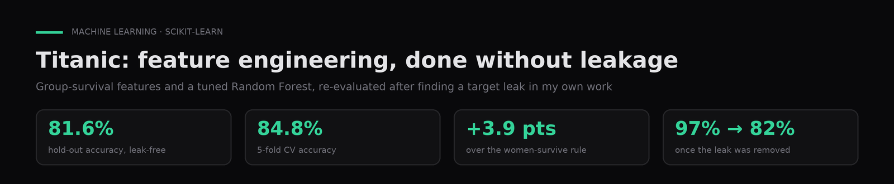
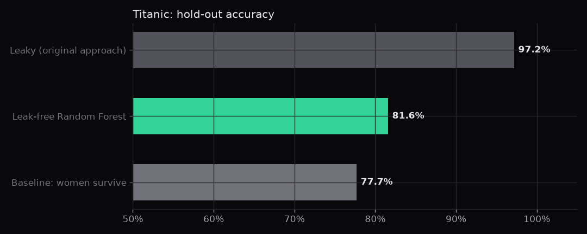

# Titanic, feature engineering and Random Forest

**Survival classification with feature engineering (titles, family, deck, ticket frequency) and a GridSearch-tuned Random Forest.**

`Python` · `scikit-learn` · `pandas` · `Seaborn` · [Leer en español ↓](#español)

---

## Problem

Predict which passengers survived from their travel data.

## Data

Kaggle's Titanic training set: 891 passengers with class, sex, age, family, ticket, fare, cabin and port. Included as `data/titanic.csv`.

## Approach

Group-wise imputation, title and surname extraction, family and deck features, mutual information, and a 216-combination, 3-fold GridSearch.

## Results

Without data leakage, the Random Forest scores 81.6% on the hold-out (84.8% cross-validated), 3.9 points above the "women survive" rule. The original 98.9% came from computing family and ticket survival rates on the whole dataset.

| Setup (same 20% hold-out) | Accuracy |
|---|---|
| Original approach: group survival rates from the whole dataset | 97.2% |
| **Leak-free Random Forest** (rates learned on the training split, leave-one-out) | **81.6%** |
| Baseline: every woman survives, every man does not | 77.7% |

**What changed.** The strongest features, *family survival rate* and *ticket survival rate*, used the `Survived` column of every passenger, test set included. In the fixed version they are learned inside each training fold, and on the training rows each passenger is left out of their own group rate.

## How to run

1. `pip install -r requirements.txt`.
2. `notebooks/01_feature_engineering_random_forest.ipynb` is the original 2024 work. It reads `data/Copia de Titanic-Dataset.csv` (copy `data/titanic.csv` under that name) and an extended course version that is not included.
3. `notebooks/02_leak_free_evaluation.ipynb` (added in 2026) re-evaluates the same idea without leakage and runs end to end.

## Context

Coursework for **Machine Learning I** in the AI & Data Science program (Colegio Universitario IES · Universidad Siglo 21, 2024). Author: **Gaspar Quintana**.

---

## Español

**Clasificación de supervivencia con ingeniería de variables (títulos, familia, cubierta, frecuencia de ticket) y Random Forest ajustado con GridSearch.**

**Problema.** Predecir qué pasajeros sobrevivieron a partir de sus datos de viaje.

**Datos.** Titanic de Kaggle (set de entrenamiento): 891 pasajeros con clase, sexo, edad, familia, ticket, tarifa, cabina y puerto. Se incluye en `data/titanic.csv`.

**Método.** Imputación por grupos, extracción de títulos y apellidos, variables de familia y cubierta, información mutua y GridSearch con 216 combinaciones y 3 folds.

**Resultados.** Sin fuga de datos, el Random Forest logra 81,6% en el hold-out (84,8% en validación cruzada), 3,9 puntos por encima de la regla "sobreviven las mujeres". El 98,9% del notebook original venía de calcular tasas de supervivencia por familia y ticket con todo el dataset.

**Contexto.** Trabajo de **Aprendizaje Automático I**, Tecnicatura en IA y Ciencia de Datos (Colegio Universitario IES · Universidad Siglo 21, 2024). Autor: **Gaspar Quintana**.
